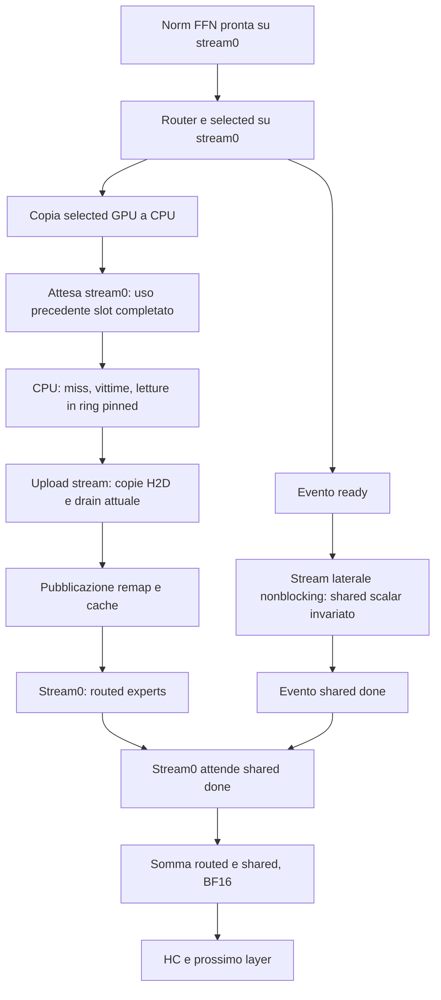

# P2C — audit stream, eventi e lifetime

Data: 2026-11-01. Stato: **audit statico completato; prototipo non implementato**.
Runtime `0ba37bd99cf3ada39423ab58a23b1e780e6f6358`, branch
`feature/external-engram-gguf`. Nessuna build, inferenza o azione lifecycle.
Servizio rimasto attivo con lo stesso PID 2337506 per tutta questa fase.
Provenienza e hash: `speed-bench/p2c-audit-20261101/provenance.json`.
Sorgenti ds4.c/ds4_cuda.cu e binari runtime identici agli hash P2A.
TokenSave non inizializzato nel worktree: ispezione diretta dei file, senza sync.

Nota 2026-11-02: dopo questo audit il branch è stato rebasato su890898cf e
validato ([report](REBASE_DS41_20261102.md)). I riferimenti e le firme di
questo documento descrivono la base precedente: aggiornarli prima del prototipo.
Nessun overlap P2C è stato implementato o promosso durante il rebase.

## Decisione

Esiste un candidato circoscritto per sovrapporre il calcolo shared-expert al
loader single-host: usare la regione generica `ds4_gpu_side_begin/end/join`
per eseguire **la sequenza scalar shared attuale**, conservando arrotondamenti
BF16, loader, cache, copie e routed kernels. Non basta cambiare una variabile:
nel percorso single-host questa regione non viene aperta oggi.

Non usare come primo esperimento `ds4_gpu_dsv41_shared_start` del TP:
può selezionare `dsv41_shared_fused`, introducendo anche un cambio di kernel.
La presenza dei confini BF16 non garantisce uguaglianza dei risultati tra
implementazioni. Prima separare scheduling da cambiamenti aritmetici.

Fattibilità dedotta dal codice, non concorrenza misurata o speedup dimostrato.
P2B ha escluso la scansione LRU (0,048ms/token); P2A trova circa25,10ms/token
nel loader, inclusivi di letture/trasferimenti. Non promettere di recuperarli:
il risparmio ideale per layer è al massimo `min(tempo_shared, tempo_loader)`
nel modello semplificato di overlap; i tempi shared separati non sono ancora
noti. Eventi, contesa di banda unificata GB10 e sincronizzazioni possono
ridurre o annullare il beneficio. Il TP su due Spark resta fuori da questa patch.

## Percorso attuale verificato

- `ds4.c:41608` ds41_moe_partial: route projection + router, shared scalar,
  poi ds4_gpu_routed_moe_one_tensor. shared_owner richiede tp_world==2.
- `ds4.c:41660`: shared gate → BF16, up → BF16, SwiGLU → BF16,
  down → BF16. ds41_matmul(round=true) applica il confine dopo ogni proiezione.
- `ds4.c:41698` ds41_moe_finish: single-host somma routed+shared e arrotonda.
- `ds4_cuda.cu:28122` wrapper scalar → routed_moe_launch;
  `:26149` il modello SSD attiva begin_load_tensor prima dei kernel routed.
- `ds4_cuda.cu:34881`: copia selected GPU→CPU con cudaMemcpy sincrona;
  `:29022` begin_load fa prefetch-before-load, invalida remap e attende
  cuda_decode_stream prima di cambiare slot.
- `ds4_cuda.cu:29156–29255`: scelta vittima, staging/copie,
  drain degli upload, pubblicazione remap e hit. Questo ordinamento resta.
- `ds4.c:42062`: single-host/streaming usa il percorso eager;
  non è il percorso decode-island TP catturato.

Oggi, graphs=0, cuda_decode_stream restituisce stream0. Lo shared accodato
su stream0 precede la copia selected e l'attesa stream0 del loader: non può
restare in esecuzione durante quelle letture. Non confondere l'overlap Engram
con questo caricamento degli esperti.

## Schema candidato

I nomi ready/done si riferiscono a eventi esistenti in g_dsv41_shared.
`ds4_gpu_side_begin` registra ready sul main prima di impostare active;
`side_end` disattiva active e registra done sul laterale; `side_join` accoda
un'attesa done sul main. **Join non significa attesa CPU completata**:
prima di liberare buffer dopo un errore serve anche un drain effettivo.

I due stream laterali (shared e upload) sono creati nonblocking
(`ds4_cuda.cu:1077`, `:2326`). Secondo la documentazione NVIDIA, gli stream
nonblocking non ricevono la sincronizzazione implicita del legacy stream0:
[CUDA stream synchronization behavior](https://docs.nvidia.com/cuda/cuda-runtime-api/stream-sync-behavior.html).
Questo consente la concorrenza, ma non la garantisce. La cudaMemcpy selected
rimane sincrona per il chiamante; gli eventuali effetti sul parallelismo,
le allocazioni lazy e il runtime vanno osservati su timeline reale.

## Proprietà e lifetime

| Risorsa | Produttore e lettori | Vincolo |
| --- | --- | --- |
| g->norm | Norm FFN su main; router, shared e routed leggono | Ready dopo produzione; niente scritture/frees fino al join e fine layer |
| selected/route_weights/route_logits | Router main, copia ID CPU e routed | Mantenere ordine router→copia; remap separato; niente reuse al layer successivo prima del completamento |
| g->shared_gate/up/mid/shared | Shared laterale, poi somma su main | Allocazioni scalar distinte; join prima della somma e di riuso/liberazione |
| g->gate/up/mid/experts/routed | Routed main | Non condividere con scratch del laterale |
| Scratch temporaneo quantizzazione | Main e shared hanno arena diversa | side active usa g_dsv41_shared.scratch, non arena main; verificare dimensione e nessuna API che bypassi il resolver |
| Pesi shared | Mappa/residenza modello, lettura laterale | Verificare residenza prima di lanciare; niente invalidazione/eviction o cambio mappa fino a fine lavoro |
| Slot cache esperti | Loader CPU/upload; routed main legge | Conservare synchronize(main), stamp, protezioni prefetch e drain upload; nessuna seconda arena |
| Ring pinned x4 | CPU legge dal file, upload legge ring | Evento per buffer prima di sovrascrivere; drain anche su errore prima di rilasciare |
| ready/done, active/pending | Stato globale CUDA | Un solo owner, nessuna regione annidata; chiudere e attendere anche sui percorsi di errore |

Le allocazioni scalar vengono da DS41_SCRATCH (`ds4.c:40956`, `:41174`).
Gli alias batch sono reali (`:41192–41206`): shared può condividere low/x,
e routed block. ds41_moe_partial è richiamato anche da percorsi prefill-row
(`:42845`). **Il solo controllo n_tokens==1 o il solo g->streaming non basta**
a distinguere un token di decode da una riga di prefill. Passare un consenso
esplicito dal percorso decode scalare, con default spento negli altri callsite.

## API e aritmetica

- `ds4_cuda.cu:36065`: generic side region reindirizza cuda_decode_stream,
  cuda_tmp_alloc_on e cuBLAS; side_begin restituisce1 aperto,0 indisponibile,
  -1 errore. Non supportata durante capture.
- `:16603–16624`: Q8 scalar usa scratch risolto per stream e kernel warp8;
  `:20765` SwiGLU usa cuda_decode_stream;
  `ds4_deepseek41_cuda.cuh:112` quantize/BF16 usa lo stesso resolver.
- `:748`: scratch laterale esplicito64KiB. Verificare cap per ogni proiezione:
  Q8 scalar richiede align16(width)+4*(width/32) byte. Non dare per garantite
  altre configurazioni, tipi o fallback. cuBLAS handle/workspace e stream/eventi
  possono aggiungere memoria oltre i64KiB; misurarla, non promettere costo totale64KiB.
- `ds4_deepseek41_cuda.cuh:252–311`: shared_start TP usa fused di default,
  ragione per escluderlo dal primo prototipo che deve mantenere i kernel.
- `ds4_cuda.cu:3969`: end_commands normalmente drena il device,
  oppure stream0 con g_cuda_end_stream_sync. Un join omesso potrebbe essere
  mascherato dal drain device: il gate deve dimostrare la dipendenza esplicita.

## Contratto del primo prototipo

Opt-in nuovo, proposto `DS4_CUDA_V41_SHARED_IO_OVERLAP=1` (non implementato).
Valore da interpretare esplicitamente; `=0` deve spegnere. Baseline unset.
Primo scope: CUDA GB10 single-host, streaming1017, **decode scalar reale**,
graphs0, shared Q8, nessun TP/batched-session/DSpark/vision/prefill-row.
Non alterare flag P1/stage-sync/topk/cache/Engram o copie nel confronto.

1. Preriscaldare stream/eventi/scratch e confermare pesi residenti prima
   della misura; registrare memoria startup, non nasconderla dal report.
2. Accodare router e aprire side_begin; se0, eseguire baseline scalar.
   Se-1, interrompere con cleanup; non procedere come se shared fosse valido.
3. Se aperto, accodare la stessa catena shared, raccogliendo esito senza
   saltare side_end in caso di errore. Active deve tornare false prima che
   il main chiami il loader: altrimenti il resolver sceglierebbe lo stream errato.
4. Lasciare integralmente loader/stream0 sync/ring/upload/remap. Il loader
   può sovrapporsi allo shared nonblocking perché usa altri buffer.
5. Accodare routed sul main; fare join prima della somma, **anche se routed
   fallisce**, quindi gestire l'esito. Nessun fallback dopo shared parziale.
6. Se shared/loader/routed/end/join falliscono: invalidare il graph;
   chiudere active, drenare shared e upload prima di riuso/frees, propagare
   errore. Non dare per sicuro ds41_graph_free da solo (`ds4.c:41008`):
   non implementa il contratto nuovo per un side-work pendente.
7. Registrare ramo realmente eseguito e fallback; guardia globale contro
   pending di altra regione. La correttezza non può dipendere dal fatto che
   il servizio oggi serializzi le richieste.

## Gate e decisione prima di promozione

Prima patch funzionale in worktree scratch da HEAD runtime, mai nel worktree
P2B o nei sorgenti di produzione. Build nice/MemoryMax9GiB/-j2 e tutti cubin121a.

- Gate corto4K:256vettori completi finiti esatti, stessa sequenza teacherforced.
- Se diverge: STOP e distinguere dispatch/scratch/race; nessuna tolleranza nuova.
- Timeline/eventi separati dai timing: dimostrare shared su side, routing main,
  letture/upload durante shared e join effettivo. Misurare shared per layer,
  loader e attesa join. Se non c'è overlap o shared è troppo breve, archiviare.
- Screening pulito AB/BA e terza coppia solo se promettente, soglie del piano;
  run senza dump/profiling e tempo dell'intera richiesta oltre al decode.
- Prima deploy:64K e254K numerici, recall16/16, output coding/tool reali,
  prefill/append invariati e memoria floor8GiB/zero swap. Nessun claim qualità
  dalla sola equivalenza corta. Includere errori e cancellazione con lavoro side
  pendente; memcheck e synccheck pertinenti. Sanitizer non prova da solo assenza
  di tutte le race tra stream: servono dipendenze e test lifetime.
- Rollback: flag assente e binario produzione originale. Nessuna promozione
  sulla base di questa analisi statica.

## Stato e prossimo passo

Audit completato, codice operativo invariato. Gate/benchmark/sanitizer nuovi
non eseguiti in questa fase. Prossimo lavoro circoscritto: implementare il solo
prototipo opt-in con guardie scalar e cleanup, poi gate4K. Non combinare
fusioni, prefetch del prossimo layer o modifica cache LRU.
